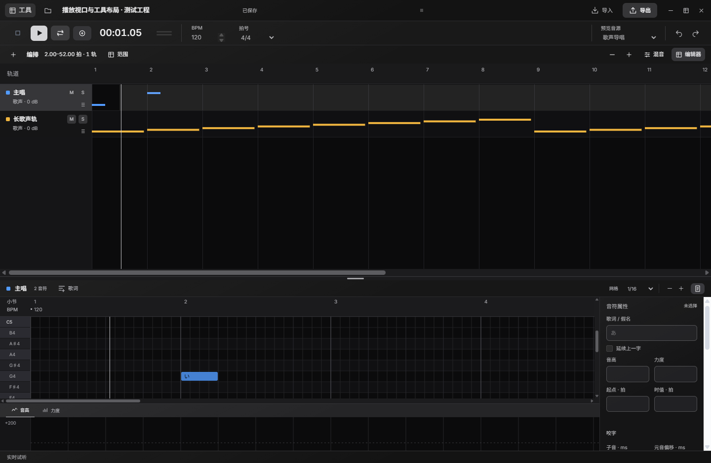
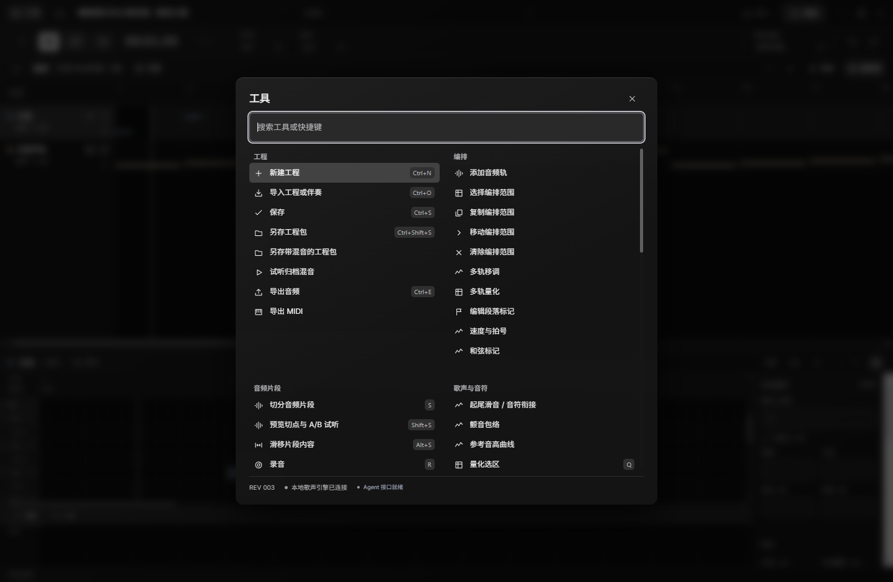

<p align="center"></p>

# Agent Vocal Studio

在 Windows 上编辑歌声、编排和混音，让 Agent 通过 MCP 操作同一份可编辑工程。

A local Windows editor for vocal sequencing, multitrack arrangement, and mixing. An MCP client can inspect, preview, and edit the same project that is open on the desktop.

[](https://github.com/Misaoys/agent-vocal-studio/releases/download/v0.99.2/Agent-Vocal-Studio-0.99.2-Windows-x64.zip) [](#mcp-接入) [](LICENSE)

## MCP 接入

**复制这一句话给 Agent**

```text
请按 https://github.com/Misaoys/agent-vocal-studio#mcp-接入 下载并解压 Windows 版，把 bin/agent-vocal-studio.exe 的绝对路径注册为名为 agent_vocal_studio 的 stdio MCP 服务，参数用 --mcp --home <解压根目录的绝对路径>，重载客户端后调用 studio_status 验证连接，后续在同一工程内只改指定范围，例外先说明，作曲时先做抓耳、连贯且贴合歌声的主唱旋律。
```

如果用 Codex，也可以在解压目录里运行下面的命令。注册后重新打开 Codex。桌面和 MCP 要使用同一个工作区，才能读取桌面选区并控制当前工程的试听。

```powershell
$studioRoot = (Get-Location).Path
$studioExe = Join-Path $studioRoot "bin\agent-vocal-studio.exe"
codex mcp add agent_vocal_studio -- $studioExe --mcp --home $studioRoot
codex mcp get agent_vocal_studio
```

<details>
<summary>其他 stdio MCP 客户端的配置样例</summary>

将以下配置中的两处路径替换为本机的实际解压路径。客户端载入配置后，可以用 `studio_status` 检查服务。

```json
{
  "mcpServers": {
    "agent_vocal_studio": {
      "command": "C:/Apps/Agent Vocal Studio/bin/agent-vocal-studio.exe",
      "args": ["--mcp", "--home", "C:/Apps/Agent Vocal Studio"]
    }
  }
}
```

</details>

## Agent 工作规则

- **在同一工程内修改。** 优先使用用户指定的工程，未指定时核对桌面当前工程。一次任务锁定同一个 `project_id`，只改指明的音轨、乐句或时间范围。确有理由新建、切换、复制或另存工程时，先说明原因，例如用户明确要求、原工程无法安全保存或需要隔离测试。
- **旋律抓耳、连贯，贴合歌声。** 先写一小段能跟着哼的主唱动机，用有辨识度的节奏和少量变化串起乐句。关键字落在自然的重音上，音高、长音和停顿贴合歌手音域、歌词咬字和换气。伴奏在主唱留白时接句，先试听主唱与简伴奏，再扩展到整首。

## 安装与启动

1. [下载 v0.99.2 Windows x64 ZIP](https://github.com/Misaoys/agent-vocal-studio/releases/download/v0.99.2/Agent-Vocal-Studio-0.99.2-Windows-x64.zip) 并完整解压到可写目录。 [查看发布说明和 SHA-256](https://github.com/Misaoys/agent-vocal-studio/releases/tag/v0.99.2)
2. 双击 `启动歌声编辑器.vbs`，或打开 `bin/agent-vocal-desktop.exe`。界面依赖 Windows 的 [WebView2 Runtime](https://developer.microsoft.com/microsoft-edge/webview2/#download-section)。
3. 需要采样乐器时，在解压目录运行 `安装乐器音源.ps1`。需要合成歌声时，运行 `安装本地歌声引擎.ps1` 配置 VOICEVOX，或按 [OpenUtau 适配器指南](adapters/openutau/README.md) 配置日语 Classic 声库。音源分别适用各自的条款。

已有工程可用 `bin/agent-vocal-desktop.exe --home <原工作区绝对路径>` 打开。MCP 服务也使用同一个 `--home`。

## 编辑器

编排和钢琴卷帘跟随播放游标滚动。左上角的「工具」汇集编排、调声、混音和 Agent 操作，支持搜索与 `Ctrl+K`。

<p></p>

<details>
<summary>查看工具面板</summary>

<p></p>

</details>

| 工作区 | 支持的操作 |
| --- | --- |
| **歌声钢琴卷帘** | 编辑音符、逐音歌词、音高曲线、颤音和跨音延续 |
| **多轨编排** | 编排歌声、复音乐器和音频片段，编辑速度、拍号及段落 |
| **试听与混音** | 实时监听干轨、编辑后更新受影响音轨、A/B 试听、轨道效果、总线路由与真峰值导出 |
| **交换与交付** | AVPROJ、AVPACK、MIDI、PPSF 曲谱导入预览、WAV 混音和对齐分轨 |

Agent 可以先读取工程版本和选区，再用 `agent_focus` 标出操作目标，预览改动后按版本提交。桌面上可以看到 Agent 正在处理的音轨和范围。 [查看 Agent 选区截图](docs/studio-agent.png)

## 从源码构建

使用 Windows x64、Rust MSVC 工具链及 Visual Studio C++ Build Tools（含 Windows SDK）。

```powershell
git clone https://github.com/Misaoys/agent-vocal-studio.git
cd agent-vocal-studio
powershell -ExecutionPolicy Bypass -File .\build.ps1
cargo test --locked
```

构建脚本把桌面程序和 MCP 服务放入 `bin/`。

## 文档与许可

- [使用手册](docs/使用手册.md) · [工程架构](docs/工程架构设计.md) · [歌声制作与返修](docs/流行歌制作与返修.md)
- 项目源码使用 [MIT 许可](LICENSE)。依赖许可见 [第三方声明](THIRD_PARTY_NOTICES.json)，内置字体使用各自的 [OFL 许可](web/fonts/)。
