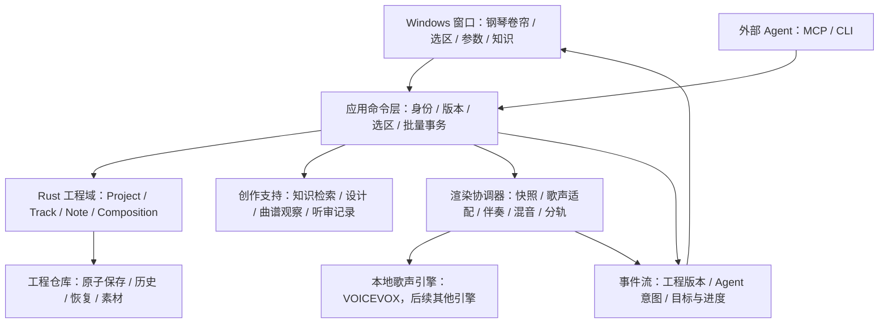
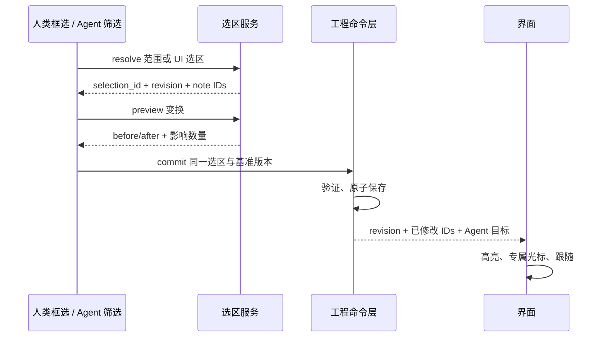

# Agent Vocal Studio — 工程架构设计

2026-11-18。本文记录现有架构、已验证能力和后续目标。软件版本以桌面「关于」及发布清单为准。

## 1. 产品与验收边界

这是一套以 Rust 为核心、供人和 Agent 共用的本地音乐工程系统。第一工作面是歌声编辑器，包含音符、逐音歌词、调声、伴奏和导出。Agent 通过结构化命令操作工程，界面根据同一份工程状态显示结果，并绘制专属光标。系统鼠标不参与 Agent 的工程编辑。

用户的核心要求转成以下验收项：

| 要求 | 验收行为 | 当前状态 |
|---|---|---|
| 本地、Rust、降低试用依赖 | 核心与 MCP 编译成 Windows EXE；本地免费歌声引擎可独立渲染 | 已实现、已实测 |
| 可编辑工程 | 原生工程保存音符、歌词、曲线、力度、颤音；工程包带伴奏素材 | 已实现、已实测 |
| 框选与指定修改 | 人可框选、多选；Agent 可按轨道、时间、音高、编号固定范围，并预览/提交 | 已实现，范围/预览/提交/失效保护已实测 |
| 不改错范围 | 修改绑定工程版本与稳定编号；范围失效时拒绝重定位 | 已实现；有独立范围测试 |
| 看见 Agent 在做什么 | 软件内 SVG 光标、目标高亮、短操作状态、可关闭的自动跟随 | 已实现，光标与输入焦点保护已实测 |
| 创作有设计 | 新歌先读知识、保存具体作品设计、逐段写作与试听 | 已实现创作设计入口与新歌写入约束 |
| 多风格知识 | 可检索乐理、风格语法、配器与听审问题，资料有出处 | 已实现 8 主题、14 风格起步指南；不等于掌握全部流派 |
| 偏 Apple 的简洁 UI | 平面工作区、SVG 图标与短标签、少说明、细分隔线 | 已实现，两个窗口尺寸与交互已实测 |
| 统一进退场动效 | 组件状态有统一时长/曲线，可跟随系统减少动态效果 | 已实现，弹窗进退场与减少动态效果已实测 |
| 专业交付 | 可恢复、可重开、分轨对齐、明确测量与听审边界 | 已实现基础链路；完整实时 DAW 功能另列阶段 |

“专业级”按完整工作流和可验证结果推进，不用漂亮界面、非静音或乐理统计替代作品质量。初音音源本身仍属于其原授权产品；本地替代歌手不标为初音。

## 2. 系统分层



界面不拥有另一份“真实工程”。鼠标编辑、Agent 命令、文件导入最终都提交到同一个工程命令层。渲染读取不可变工程快照，不能边渲染边读被修改的活动工程。

### 已实现的源码映射

| 模块 | 文件 | 职责 |
|---|---|---|
| 领域与持久化 | `src/model.rs` | 稳定 ID、验证、事务、历史、原子保存、备份恢复 |
| 范围编辑 | `src/selection.rs` | 范围解析、UI 选区、版本绑定、变换预览 |
| 创作支持 | `src/music.rs`, `knowledge/music.json` | 知识检索、设计结构、观察性曲谱报告 |
| Agent 在场感 | `src/presence.rs` | 有界操作日志、目标语义、序列号 |
| 应用与协议 | `src/service.rs` | MCP、CLI、本机 HTTP、任务管理、会话令牌 |
| 采样与乐器 | `src/instruments.rs` | 真实音色目录、复音采样、程序/鼓组与 MIDI CC |
| 任务协调 | `src/jobs.rs` | 阶段进度、取消顺序、原子回执、重启恢复 |
| 音频传输 | `src/http_audio.rs` | 文件流式传输、HEAD/字节范围、独立慢客户端 |
| 桌面试听 | `src/transport.rs` | Rust WASAPI 输出、源帧游标、循环、电平 |
| MCP 试听控制 | `src/transport_link.rs` | 本机转接、播放归属、人工接管、命令时限 |
| 歌声与混音 | `src/engine.rs` | VOICEVOX 歌声 API、曲线/颤音、混音、分轨与测量 |
| 音频素材 | `src/audio.rs` | WAV 解码、窗口 sinc 重采样、素材入库 |
| 格式互通 | `src/exchange.rs`, `src/midi_exchange.rs` | MIDI 程序/鼓组/复音/CC、PPSF 读取、原生工程与可移植工程包 |
| 编辑界面 | `web/app.js`, `web/pro.js`, `web/instruments.js`, `web/jobs.js` | 卷帘、属性、框选、多选、伴奏、循环、快捷键 |
| Agent 与知识界面 | `web/agent.js` | 专属光标、自动聚焦、作品设计与知识面板 |
| 视觉与动效 | `web/design.js`, `web/apple.css`, `web/motion.js` | SVG、平面布局、设计变量、组件动效 |

桌面程序 `agent-vocal-desktop.exe` 用应用绘制标题栏、窗口控制、命令面板、文件选择和确认。Tao 创建宿主窗口，Wry 通过 WebView2 绘制应用资源。`file_browser.rs` 在 Rust 中分页读取目录、校验保存目标，导出通过同目录临时文件原子移入。桌面用私有协议与受限 IPC，后台 HTTP 服务的根地址返回 404。Agent 使用独立的标准输入输出 MCP 入口。

按工作区加锁的窗口实例保留尺寸和最大化状态，项目标题显示在系统标题栏。系统保存对话框只接收已生成的应用导出文件。副本先写入目标目录的临时文件，完成后原子替换。窗口关闭等待排队的编辑完成。

### 专业版本的 Rust workspace 拆分设计

```text
crates/
  score-domain/       # 无 I/O 的工程、音符、时间与命令验证
  score-application/  # 事务、选区、权限范围、预览与事件
  project-store/      # 快照、操作日志、恢复、迁移、素材校验
  music-knowledge/    # 知识条目、案例、来源与任务检索
  composition/       # 作品设计、发展计划、听审记录
  render-core/       # 渲染图、时钟、离线混音、分轨
  engine-adapters/   # 歌声、采样器、外部工程适配器
  agent-protocol/    # MCP、CLI 与版本化协议 DTO
  desktop-shell/     # Windows 桌面窗口、文件关联、系统菜单
ui/
  editor/            # 钢琴卷帘、时间轴、选区、参数与动效
```

先按职责拆分，再按部署需求拆进程。避免在领域层引用 WebView、HTTP 或具体歌声产品。当前 Windows 桌面壳采用 Tao、Wry、Muda 和 RFD。跨平台打包、输入法扩展测试与安装器留在后续阶段。

## 3. 工程数据与时间

当前 `agent-vocal/2` 工程提供以下结构。

- `Project`：工程 ID、递增 revision、标题、起始 BPM 和拍号、变速与拍号表、导出尾音、音轨、作品设计。
- `Track`：稳定 ID、中文名称、静音/独奏、电平、声像、歌手或采样音色、MIDI 控制器、音符或伴奏素材。
- `Note`：稳定 ID、起点/时值（四分音符拍）、MIDI 音高、逐音歌词、力度、相对拍的 cents 曲线与颤音。
- `AudioClip`：入库素材 ID、起点拍、真实音频长度；原文件不改写。
- `Composition`：用途、具体立意、风格、调性、动机、情绪变化、段落与配器职责。

当前每个歌声音轨为单声部。和声使用独立音轨。采样乐器允许不同音高的复音；同音高重叠重击需要独立轨。乐器控制器支持 CC 1/7/10/11/64/91/93，实际音色来自校验后的 GeneralUser GS 2.0.3。6/8 的一小节是三个四分音符拍，不能把 BPM 单位与小节拍号混淆。

音乐时间以四分音符拍表示。采样时间由时间表换算，界面小节编号由拍号表推导。速度点可阶跃或从上一个速度点线性渐变。渲染、伴奏定位、波形、播放与循环使用同样的时间约定。颤音周期按秒计算，音高曲线按拍定位。拍号变化开始新小节，也可表达短小节。旧 `agent-vocal/1` 工程可直接读取，编辑时进行版本迁移并保留备份。

MIDI 中的速度和拍号事件可进出工程。线性渐变导出时分割成有限 MIDI 速度事件。原生工程与工程包保留精确曲线。音频片段以拍为锚点，导入长度按秒保留，也可切换到跟速与分段对拍。变速 PPSF 的兼容仍待验证。

### 多轨编排

编排视图在同一小节坐标中呈现作品设计、各轨音符和伴奏时长。WAV 以拍为锚点，跨度按时间表换算原始秒数。`arrangement_query` 提供各轨范围和各段的实际覆盖，支持检查声部何时进入及哪些段落仍缺素材。用户的框选通过已有的选择接口发布精确音符 ID。

`arrangement_edit` 预览按工程版本、源范围、目标拍和音轨生成摘要标识。复制用新 ID 保留歌词、力度和调声，移动保留原 ID。目标占用、音符跨边界和并发提交都会拒绝。正式提交重算同一预览，再通过共享存储流程原子保存为一个撤销步骤。范围编辑针对音符，伴奏、控制事件、段落设计、速度与拍号各自保留。预览会列出目标或源范围内保留在原位的 MIDI 控制点数量。

Agent 可以通过 `agent_focus` 准确定位到编排的音轨和拍范围。画布使用和卷帘共用的时间表，浏览长工程时只绘制屏幕范围内的图形。监听、音频伸缩及混音路由均使用工程的同一套轨道标识。

### 音频片段

`agent-vocal/3` 的音频轨存储片段数组。每个片段引用素材 ID，位置为四分音符拍，源偏移、长度和淡化为 48 kHz 整数帧。迁移发生在第一次片段编辑，旧工程和撤销状态继续使用原结构。切分时用时间表把左右边界映射到同一个输出帧，两个片段引用相邻源窗口。裁剪到新边缘时重置相关的淡化，预览会提示。音频素材和历史快照由工程保存保护。

移动和复制保留源时长，允许放到其他音频轨。目标与同轨片段相交时，需通过预览明确允许叠放。渲染按窗口定位到 WAV 样本，依次施加片段与音轨的增益、淡化和声像。每条音频轨生成一份全长分轨，同轨叠放以加法混音。工程包中同一素材只保存一次，导入新工程时复用它对应的源 ID。

`audio_clip_edit` 先返回帧范围和变更后 ID，再在同版本按预览标识提交。旧片段在迁移前使用轨内标识 `legacy`，后续使用回执里的稳定 ID。没有额外写入轨道时，音频片段编辑中的移动保持 ID，切分新建右侧 ID，复制新建 ID。实测变速下的切分前后以及工程包重开前后，输出 PCM 完全一致。

`audio_waveform` 在一次源窗口读取中生成峰值并可选分析起音。检测使用 48 kHz 片段相对帧号。分析裁剪后的窄区间时，读取窗口前最多约 20 毫秒建立能量参考。候选的工程拍位使用 `Clip::beat_at_source`，与片段速度、起点及现有对拍点保持一致。桌面与 MCP 共用这一入口的分析逻辑。候选只是读取结果，移动素材由带工程版本的对拍预览和提交完成。

桌面按素材 ID、源偏移和长度缓存精确波形。切分或裁剪后，已有覆盖缓存时先按原始源帧位置绘制重叠的峰值区间，再用当前工程版本的精确结果替换。缓存失败状态绑定本次工程版本及片段，一个读取失败的范围可自动重试一次，下一版本可重新读取。编排和详情区共用更新事件。

后端为最近读取的八份素材缓存每 256 源帧的双声道峰值。完整落在同一输出格内的块可直接合并，跨边界的块按原样解码，输出与逐帧扫描一致。并发请求只对同一素材的缓存加锁。带起音检测的请求仍逐帧分析，保留起音所需的历史窗口。

`audio_clip_group` 以明确的 `(track_id, clip_id)` 列表计算跨轨移动、复制、增益或移除。整体位置以四分音符拍移动，音频源窗口仍由样本帧定义。目标与未选片段碰撞，或变速使原本分开的组内片段碰撞时，整组拒绝。所有合法目标一起提交成单次撤销。桌面通过内部调用公布音符、片段 ID 和编排范围，`audio_clips(from_ui=true)` 读回同版本的精确片段选区。Agent 的范围事件包含每个目标轨和拍区间，工作区在用户选区之外叠画。


A/B 使用当前工程和已经验证的候选工程，沿用相同的歌声、采样乐器与效果器链。每版在自己的速度映射下转换同一对拍点。工作线程生成完整混音以保留进入选区前的音色状态，再裁取最多 45 秒。两版先装到内存，切换时按实际节拍映射位置并交叠 8 ms。可按区间双声道 RMS 匹配。静音方案保留原电平，试听文件留在当前任务的运行目录，发布导出、工程历史与原始轨缓存独立。

调声面板可选局部干声试听。以相同拍区间为中心两侧各读取 0.85 秒，并纳入跨过边界的完整延续音节。VOICEVOX 输入从相邻音节前开始，预测和调声仍使用全局量化帧定位。解码后裁到准确的工程采样范围，试听回执记录 `local_voice`。局部试听的合成上下文有限，因此单独保存于临时 A/B 结果，正式渲染继续使用整轨原始轨缓存。


## 4. 命令、事务与选区

命令统一携带工程身份、基准版本和明确目标。不存在“随便改当前窗口”的写接口。

```text
CommandBatch {
  project_id,
  expected_revision,
  operations: [typed operation],
  source: user | agent
}
```

执行顺序：读取目标 → 核对版本 → 在副本应用全部操作 → 验证最终状态 → 备份 → 原子替换 → 发布新版本及操作事件。任一操作非法，整批不落盘。撤销与重做也递增版本，不回拨 revision。

### 框选与指定修改

人类可拖空白处框选、Shift 点击增减、Ctrl+A 全选，再改属性、移调、量化、复制、删除。多音选择修改音高/起点时按当前音符作为锚点移动整个所选乐句，保留相对音程和时序。

Agent 可通过 `selection_resolve` 使用：

- 轨道 ID；
- 时间范围，起点包含、终点不包含；
- 音高范围；
- 音符 ID；
- 当前 UI 选区。

返回的 `selection_id` 绑定工程版本与具体音符集合。`selection_edit` 默认只预览，返回逐音 before/after；提交时再次核对版本。预览不是要求用户额外批准，Agent 可在核对结果后自主提交已授权的编辑。



范围外的音符必须逐项保持不变。工程变化后旧选区失效；不自动扩大范围。删除、移动和转调的重叠、越界、曲线时长问题由最终状态验证处理。

## 5. Agent 的专属光标与聚焦

光标属于渲染层，不是用于控制操作系统的鼠标。Agent 始终先完成语义操作，光标说明发生了什么；光标位置不会反向决定改到哪一个音符。

事件包含序列号、工程/音轨/音符 ID、目标区域、短操作说明、时间和版本。区域使用固定枚举：卷帘、歌词、音高、力度、混音、传输、作品设计。

界面行为：

1. 读取比当前更新的工程状态。
2. 定位相应工程、音轨和音符。
3. 在可跟随时滚动到目标，显示 SVG 光标及轻量高亮。
4. 人正在拖拽、输入或操作弹窗时，保留其输入，只更新活动状态。
5. 关闭“跟随”后，继续显示活动状态，停止自动滚动与光标跟随。

事件队列有界；断线后按序列恢复。工程本身才是事实来源，日志缺段时重新读取工程。首版使用短轮询；专业版事件传输采用带恢复游标的订阅通道。

## 6. 创作知识与作品质量

知识不是一套自动给作品打“好听分”的规则。知识条目保存主题、适用范围、制作原则、常见误区、试听问题、来源与复核版本。用户反馈可以形成工程内的修订记录，但不能冒称训练了模型。

内置工作顺序：具体立意 → 动机与骨架 → 主唱和简伴奏 → 和声与节奏组 → 配器发展 → 演唱 → A/B 试听 → 工程交付。

新歌设计至少写明：

- 主题中的具体行为和矛盾；
- 风格及其贡献的具体语法；
- 调性、旋律/节奏动机；
- 说话人的情绪变化；
- 各段落的时间与职责；
- 配器分工及进退；
- 歌词语言与参照职责。

首版 Agent 从空工程写音符前，需要保存设计。技术测试必须明确标注，仅限短片段，不能拿测试标签承载成品歌曲。导入已有作品时优先保留原始旋律和歌词，用户认可的部分不随意重写。

曲谱报告只观察时值分布、音程、连续演唱跨度、重复轮廓、音域和段落密度。循环、极简、说唱与不同演唱传统有不同语法；观察值不能成为统一审美阈值，更不能把简单音乐判成低级。

专业版增加：案例的分段听辨记录、具体参考职责、主唱/伴奏冲突注记、逐句语义重音、修订 A/B 与用户选择。风格卡随经过验证的案例扩展，不承诺覆盖所有文化与流派。

## 7. 歌声、伴奏与渲染

已实现链路：冻结工程 revision → 歌声与采样乐器分别渲染 → 编译带休止的歌声音符 → 本地引擎返回音素/F0/音量帧 → 叠加已实现的音高曲线、颤音与力度 → 合成音频 → 去除固定预留头部 → 对齐 48 kHz 时间轴 → 混入伴奏 → 共享衰减 → 24-bit 混音与分轨 → 测量与工程快照。

采样乐器使用 RustySynth 1.3.8，实际读取 287 个预置，包括 128 个 GM 主音色。音符开关和 CC 在采样时间轴调度；鼓组使用独立映射。纯乐器工程不触发歌声合成。音色库固定版本与摘要，署名和许可随导出保留。

本机 VOICEVOX 通过 `/sing_frame_audio_query` 与 `/frame_synthesis` 合成，歌手与样式由 `/singers` 提供。OpenUtau 适配器提供本机日语 Classic 声库的 WORLDLINE-R 渲染。按工程渲染时由各歌声轨绑定的音源分别生成干轨，统一在 48 kHz 时间轴对齐。渲染回执保留音源、歌手署名和引擎规则信息。在渲染回执中可核对实际音源组合。

伴奏 WAV 入库后转换为 48 kHz 浮点素材；不同采样率使用窗口 sinc 重采样。音频声道保持独立，不把立体声伴奏折成单声道。所有分轨从同一时间起点输出，并共享最终衰减量，重建混音时允许量化误差，不允许时序错位。

桌面试听由 CPAL 的 WASAPI 后端输出离线渲染完成的双声道混音。专用控制线程解析 48 kHz PCM WAV，并把缓冲、定位和循环发布给音频回调。回调从缓冲取帧，以整数比例累加设备帧和源帧的关系，在循环结束帧之前回绕。回调无需文件 I/O 或动态分配，争用时输出静音并记录回调计数。界面从回调状态读取位置和峰值。游标表示已提交给设备的音频位置，尚未测量端到端硬件延迟。

输出走 Windows 默认设备的 WASAPI 共享模式。48 kHz 输出直读源采样，其他设备以窗化 sinc 重采样。输入录音使用 WASAPI 采集，依据输入和输出时间戳对齐随伴奏录音，并接受用户输入的毫秒校正值。待导入录音先独立落盘，确认轨道与拍位后再提交工程。后续架构项包括实时歌声合成、独占或 ASIO 输出、实体传输延迟校准和 VST3 宿主。

`desktop_transport` 由后台校验工程版本、完整渲染回执与试听范围，再使用带每次启动凭据的本机短连接转给桌面 Rust 播放线程。本机入口只接受经过认证的 POST 请求并拒绝浏览器 Origin。控制令牌绑定本次桌面会话与控制代次。在人使用播放控件后，旧令牌失效。准备人工试听期间和用户播放中，Agent 的播放请求会收到明确拒绝。Agent 命令在装载音频后再次检查有效期和控制代次，再启动设备输出。桌面事件只把状态和意图交给界面绘制。

### 已实现的任务生命周期

`render_start` 返回稳定 job_id 和工程版本。`render_status` 返回阶段、当前音轨、已完成工作量及是否可取消；百分比不作为剩余时间预测。`render_jobs` 找回最近回执与活动任务，避免连接超时后重放。

`render_jobs(active_only=true)` 供界面短轮询，只读当前任务。按工程、版本及音源查询可复用的已发布混音时优先根据持久索引读取对应回执。索引缺失时可从近期任务重建。试听游标使用独立合成层，设备进度更新无需重画音符或波形。

离线渲染先从 `runtime/source_cache` 按输入指纹取得原始轨。指纹包含速度映射、音符、MIDI 控制、歌手、片段窗口及后端版本，混音参数在另一阶段处理。文件名和头部都带指纹，先完整写入再发布。新指纹使用独立的路径，已打开的读取句柄按原快照继续取样。写入会保留同轨同音源的两个近期候选，便于并行打开相邻版本，然后尝试回收更早的缓存。缓存读取失败时按原始输入生成音频。导出按当前工程版本处理插入、推子、总线和对齐分轨。

音轨的缓存指纹与工程总采样数独立。缓存文件按当前工程长度追加最多 1 秒的实际采样，读取时用文件头指纹和有效帧数共同校验。更短或少量延长的工程可读取同一干轨的对应前缀。采样乐器的预留区间仍由合成器演奏，能保留踏板和释放尾部。超过已覆盖帧数时重新生成。正式混音和实时播放仍使用工程逻辑长度。

桌面长混音使用 `monitor_stream.rs`。启动时准备当前位置附近的少量 PCM 页，后台线程根据原子发布的当前位置与循环起点预读并替换固定数量的缓存页。每次设备回调只尝试一次缓存读取锁，文件读取和解码在锁外执行。缺页期间游标停在待读采样，下一回调可从同一位置恢复。A/B 与录音对齐使用预先载入的音频。 [实时音频文件读写的设计参考](https://computermusic.org.au/proceedings/ACMC2014-proceedings/bencina-interfacing-real-time.pdf)

### 混音信号链

`effects.rs` 以 48 kHz 处理立体声帧。片段增益与淡化先进入音轨，插入按保存顺序处理，随后应用轨道推子和声像。均衡提供双二阶低切、峰值和高切。压缩器共享左右声道峰值检测，支持软拐点和并行混合。延迟含阻尼反馈和左右交替，混响以反馈梳状滤波与扩散网络生成尾音。参数从 `effect_catalog` 提供给界面和 Agent。 [W3C Audio EQ Cookbook](https://www.w3.org/TR/audio-eq-cookbook/) · [AES 动态压缩设计](https://aes.org/publications/elibrary/elibrary-page/?id=16354)

`live_mix.rs` 从已载入混音的发布回执核对工程版本，并在音频控制线程上准备效果链。长工程或轨道数据较多时，`monitor_stream.rs` 以轨道顺序将同一帧区间装入共享缓存页。回调取得整页后才推进效果状态，页缺失时保留采样游标。WASAPI 回调重用 EQ、压缩、延迟、混响算法。滤波和时常按设备采样率计算，变化的轨使用 8 ms 交叠，其他轨保留效果状态。文件读取、动态分配和退休链回收由后台线程或控制线程执行。保存或取消草稿时保持设备位置，音源改变后重新建立监听。实时总线为零前瞻。

同长度、同速度表、兼容音轨与总线的编辑交给单独的监听准备线程。同时只保留一个执行中版本和一个待处理版本。线程按指纹只生成变化的干轨，在当前采样位置预读并准备替换输入。控制线程核对待处理版本后接入，保留播放状态、采样位置及已有处理器。受影响的输入以 8 ms 从已有样点过渡到新信号。监听报告同时回传可见工程版本与实际使用的干轨版本。

VOICEVOX 监听的局部改谱使用旧版与新版音符范围的并集寻找休止，保留完整的延音链和合成上下文。新旧干信号在两侧接缝均低于阈值时，用 10 ms 淡化接入当前监听区间。区间外沿用原始 PCM，新增片段按版本顺序覆盖，已打开的基础 PCM 文件句柄由本次监听保留。分轨分页线程读取时组合基础 PCM 与局部片段，设备回调使用已准备好的页面。局部片段保存在本次监听会话内，超出区间、上下文或内存预算时整轨重算。导出只使用完整源缓存。

导出总线前瞻限制器计算每帧共享增益。混音与分轨共用这条包络，在左右声像和时间对齐下限制分轨过载。采样峰值和真峰值可选。真峰值模式使用四倍过采样并复测量化后的 24-bit PCM。导出报告记录整段响度、瞬时与短时最大值、真峰值声道与位置。

混音器将原始轨、插入链和轨道推子分开。监听准备可加载静音及独奏外音轨，导出的混音与分轨继续按工程的 M/S 状态生成。监听绑定轨道 ID 和音源指纹。电平、声像、静音和独奏走 8 ms 推子过渡，保留插入链的衰减状态。轨道电平表采集推子后的左右峰值，总线电平表采集限制器后的输出。推子与声像在拖动中只发监听值，释放后提交单次有版本的工程编辑。

有混音参数的原生工程升级到 `agent-vocal/4`，原版本可继续编辑。插入链与总线参数进入同一工程事务、撤销和 `avpack`，MIDI 仍承载曲谱及已支持的控制事件。

`render_cancel` 是协作取消：采样、导唱、混音和写文件阶段按块检查；VOICEVOX 当前 HTTP 请求需要返回后才停止，期间保留 busy 与 cancelling 状态。不会结束共享引擎。取消和最终发布通过同一任务锁排序；进入输出提交后明确返回不能取消。

工作文件先写入独占的 `runtime/render_work/{job_id}`，成功后同卷重命名到 `exports/{job_id}`，不发布半份分轨。任务回执原子写入 `runtime/jobs`；取消/失败会清理本任务临时目录。进程崩溃的未提交目录保留在内部，重启读取为 interrupted，不自动重试；已有完整报告的结果可恢复为 complete。

真实验证包括：乐器取消约 63 ms；真实歌声请求中取消约 3.0 s；页面刷新重连；强制终止本软件测试服务后恢复完成/取消/失败回执，未发布任务标为中断。具体环境与证据见 `verification`，不是跨设备时延承诺。

### 引擎适配器设计

```text
capabilities() -> timing / phonemes / pitch / volume / timbre / languages
list_voices() -> 实际安装与可用状态
validate(score, controls) -> 支持项与明确错误
prepare(snapshot) -> 可复现的中间计划
render(plan, cancellation, progress) -> 音频、对齐信息、证据
```

新增歌声适配器前核对实际引擎、已授权音源和可编辑的演唱参数。工程导入得到的音符与歌词可以交给本机已配置的音源演唱。

## 8. 保存、恢复与互通

`projects/*.avproj` 当前保存工程与有限撤销历史。写入临时文件并刷盘，再由系统原子替换；前次版本留备份。恢复时保留损坏文件，不直接覆盖唯一证据。

`assets/` 保存入库音频，`exports/` 保存不可变渲染快照与导出记录。`.avpack` 包含工程 JSON 和伴奏素材，导入新建工程并重新分配素材 ID。歌声轨的原词用稳定音符 ID 绑定，多轨编辑在同一冻结候选里计算落字影响、试听和提交。

MIDI 互通保留音符、歌词、速度与拍号，以及乐器复音、bank/program、鼓组和已支持的 CC，不包含当前全部调声。PPSF 导入保留已解析的音符、歌词与时值，专有调声、合成缓存与插件音色不冒称无损迁移。

专业版本增加内容寻址素材、校验摘要、压缩包资源预算、独立视图状态、命令日志与快照压缩、迁移前备份，以及工程包跨机器往返测试。文件格式的破坏性升级必须增加 schema 版本与可重复的迁移器。

## 9. 视觉与动效架构

详细设计见 `界面与交互设计.md`。常驻界面只保留项目/音轨、播放控制、卷帘、表达曲线和参数。知识、设计与复核按需打开，避免在编辑器里铺满说明。布局使用分区和细分隔线，不使用卡片套卡片。

动效由统一配置控制：按压、反馈、选择、插入、移除、面板进入/退出、提示、Agent 跟随。交互反馈不阻塞工程提交；拖拽和播放游标服从输入与音频时钟，不能为了平滑而篡改时间。支持系统减少动态效果与可配置节奏。

## 10. 并发、故障与边界

| 情况 | 处理 |
|---|---|
| 人与 Agent 同时写同一版本 | 只接受一个提交，另一个返回冲突并要求读回 |
| 批次中后一个音符非法 | 前面的修改也不落盘 |
| 选区后工程已变 | 旧 token 失效，不静默重选 |
| 请求超时、写入结果不明 | 读取当前版本与目标编号后判断，不能盲目重放 |
| 渲染时工程继续修改 | 渲染仍绑定旧快照，界面标明需更新试听 |
| 引擎不可用 | 保留编辑与保存；导唱音明确不合成歌词 |
| 音源或伴奏缺失 | 返回具体缺口，不交付静音成功 |
| 工程损坏 | 使用已验证备份恢复并保留损坏副本 |
| UI 事件丢失 | 重读工程；操作日志不替代工程事实 |
| 超大工程/压缩包 | 在解析前后分别限制字节、展开体积、音轨和音符数量 |
| Agent 选中不明范围 | 返回明确目标集合和影响数量，再提交 |

当前单进程仓库锁保证已实现路径的互斥。专业版把磁盘 I/O、引擎请求和重采样移出仓库临界区，采用每工程命令队列与后台任务池；实时音频不与其共享阻塞锁。0.2 的 GET/HEAD 在独立工作线程传输，音频按文件流及字节范围发送；慢音频读取不再阻塞主控制入口。studio_status 的引擎探测移到仓库锁外。正式桌面和 MCP 按工作区分配回环端口。工作区锁限制每个目录只运行一个服务，连接通过本地会话文件发现。每个工作区允许一个活动渲染，部分导入和导出操作仍持仓库锁。

## 11. 分阶段交付与测试

Studio 负责编辑、播放、渲染、保存和验证工程。模型、对话与 API 密钥由外部智能体客户端管理。桌面保留外部操作的光标、目标范围和执行状态，人可以随时接管播放和编辑。

### 第一阶段：稳定对外 MCP

在 Codex 和另一个独立 stdio 客户端验证工具发现和完整工作流。打开并读取工程，解析桌面框选范围，预览、提交及撤销修改，渲染并试听对照，保存工程包与分轨，最后重开核对。用两端同时提交验证版本冲突和明确的错误回执，用桌面验证外部光标、实际操作状态和人工接管。客户端直接读取接口和回执完成操作。

### 第二阶段：桌面编辑与监听

优先完善多轨框选、快捷键、音频剪辑、歌声调音和混音。桌面与 MCP 共用编辑、预览、版本检查和撤销逻辑。用长工程检查打开耗时、拖动、缩放、播放起步和设备切换。实际窗口检查近黑配色、轨道辨识度、键盘焦点、窗体拖动和阴影。智能体界面只呈现外部调用的目标、操作、进度和结果。

### 第三阶段：作品与发布验收

用一首可编辑歌曲验收编曲、歌声调音、混音和分轨交付。人工试听确认返修方向，并重开工程核对素材和结果。通过独立工作区安装、旧工程升级和恢复测试后发布 Windows 构建。录音延迟补偿和第三方插件宿主随后专项推进，以实录、播放、导出和重开结果验收。

### 验证矩阵

- 领域：原子回滚、冲突、稳定 ID、撤销重做、音符重叠与曲线边界。
- 选区：时间与音高边界、范围外不变、预览不写入、失效 token、UI 选区往返。
- 文件：重开、恢复、中文路径、格式版本、缺失素材、工程包素材隔离。
- 音频：非静音、无削波、采样率、长度、固定起点、分轨相加重建混音。
- Agent：真实 MCP 握手、工具调用、错误状态、光标语义和焦点抑制。
- 创作：设计保存与迁移、测试用途限制、统计报告不冒称听审。
- UI：框选、复制、量化、属性、弹窗、键盘、不同窗口大小与减少动态效果。
- 安装：无开发环境的二进制启动、引擎缺失、端口冲突、退出与重开。

性能指标先作为目标，不能写成已测成绩。最终报告应记录工程规模、设备、耗时、内存、帧率和测量方法，再据此调整架构。
